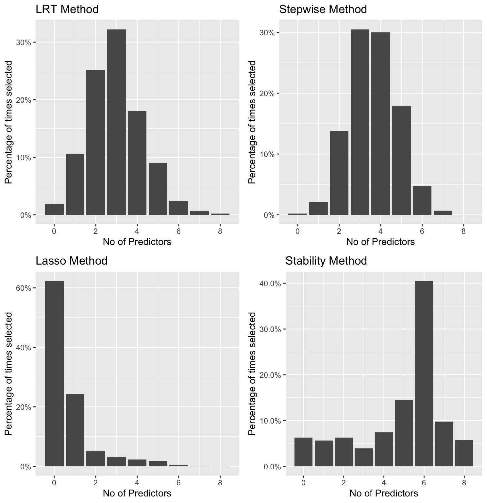

# Stability Selection in Logistic Regression


**BSc (Hons) Mathematical Sciences thesis, Technological University Dublin, April 2020.**
Jayaram Gokulan, supervised by Dr Joe Condon.

> When a model has many candidate predictors, how reliably do variable selection
> methods find the ones that really matter, once sampling variation, irrelevant
> predictors, random noise and sample size are taken into account?

The thesis compared four methods (the likelihood ratio test, stepwise
selection with AIC, the lasso, and stability selection around the lasso) in a
Monte Carlo study built on a logistic regression model from the Growing Up in
Ireland study.

📄 **[Read the thesis](thesis/Stability_Selection_in_Logistic_Regression_Gokulan_2020.pdf)** ·
[viva slides](thesis/Presentation_Viva_May_2020.pdf) ·
[original R code](code/original/) · [erratum](#erratum)

## The reasoning, section by section

Each document explains one part of the thesis: what was done, the idea behind
it, how it was implemented, and a short R example on simulated data.

| | Thesis | Document | Example |
|---|---|---|---|
| 1 | 1.3 | [Logistic regression: the model, the logit link, maximum likelihood by Newton-Raphson](docs/01-logistic-regression.md) | [R](R/01_logistic_regression.R) |
| 2 | 2.1 | [Likelihood ratio test as a selection rule](docs/02-likelihood-ratio-test.md) | [R](R/02_likelihood_ratio_test.R) |
| 3 | 2.2 | [Stepwise selection with AIC](docs/03-stepwise-selection.md) | [R](R/03_stepwise_selection.R) |
| 4 | 2.3 | [The lasso and choosing λ by cross-validation](docs/04-lasso.md) | [R](R/04_lasso.R) |
| 5 | 2.4, 3.5 | [Stability selection](docs/05-stability-selection.md) | [R](R/05_stability_selection.R) |
| 6 | 3 | [The simulation study: scenarios, noise, sample sizes, pseudo-code](docs/06-simulation-design.md) | [R](R/06_simulation_study.R) |
| 7 | App. A | [The preliminary Monte Carlo experiment](docs/07-monte-carlo-experiment.md) | [R](R/07_monte_carlo_experiment.R) |
| 8 | 4 | [Comparing the methods: selection models, Kruskal–Wallis, Wilcoxon](docs/08-comparing-methods.md) | [R](R/08_comparing_methods.R) |

## What the thesis found

- **Stability selection usually improved the lasso.** It raised the
  probability of selecting the true predictors in most settings, in scenario 2
  to 85% against the lasso's 15%.
- **It was "overly inclusive".** It also let in more noise predictors than
  the other methods (Fig 4.3).
- **Random noise in the linear predictor** (scenario 3) disrupted every
  method. Stability selection was almost equally likely to select six true
  predictors or none (Fig 4.4).
- **Of the traditional methods,** stepwise was more consistent than the LRT,
  which tended to miss true predictors.
- **Larger samples helped** every method, in every scenario.
- **Choosing λ:** the smallest λ in the stability-selection range always gave
  the highest selection counts. This made the range itself redundant, and
  better ways of choosing λ were left as future work.



## Erratum

Re-reading the thesis code, I found an error that affects one
scenario.

**What.** In the scenario-1 lasso loop (true predictors only), line 157 of
[`thesis_simulation_study_2020.R`](code/original/thesis_simulation_study_2020.R)
sets `Lasso_Coeff_rd = c()` once, **before** the 1,000-run loop starts on
line 158, instead of inside it. Predictors selected in earlier runs were
therefore counted again in every later run. The lasso loops for scenarios 2
and 3, and all the stability-selection loops, reset correctly.

**Size of the effect.** I reran that block on the original data, keeping
everything else as in the thesis code, with and without the reset, for 150
runs ([check script](code/erratum/check_lasso_counter.R)). The table gives
the number of runs that selected 0, 1, …, 8 of the true predictors:

| Lasso, `lambda.1se` | 0 | 1 | 2 | 3 | 4 | 5 | 6 | 7 | 8 |
|---|---|---|---|---|---|---|---|---|---|
| n = 500, as written | 0 | 0 | 0 | 0 | 0 | 0 | 2 | 25 | 123 |
| n = 500, reset each run | 84 | 30 | 13 | 11 | 6 | 4 | 2 | 0 | 0 |
| n = 5,000, as written | 0 | 0 | 0 | 0 | 0 | 0 | 0 | 0 | 150 |
| n = 5,000, reset each run | 0 | 0 | 0 | 1 | 3 | 18 | 22 | 49 | 57 |

The thesis's Fig 4.1 lasso panel (880 of 1,000 runs at 8, 115 at 7) matches
the "as written" pattern.

**What it changes.**
- **Affected:** the lasso panel of Fig 4.1, and the scenario-1 statements in
  sections 4.2(a), 4.3(a) and 5.1 that the lasso was the best method and that
  stability selection did not improve it. Corrected, the lasso at `lambda.1se`
  selects few or no true predictors at n = 500. Set against the thesis's
  stability-selection results for the same scenario (median 6 true
  predictors, from a loop that resets correctly), stability selection did
  improve on the lasso here too.
- **Resolved:** the "counterintuitive" deviation the thesis flagged for
  future work in section 5.2.
- **Unaffected:** scenarios 2 and 3, the LRT and stepwise results, and the
  sample-size findings.

The thesis and its code are published unchanged, as submitted.

## What is in this repository

```
thesis/          the thesis as submitted (signature removed) and the viva slides
code/original/   the R code written for the thesis, unchanged
code/erratum/    the check described above (needs the original data)
docs/            one methodology document per thesis section
R/               short explanatory examples on simulated data, one per document
figures/thesis/  result figures taken from the thesis
```

## Data

The thesis used a subset of the [Growing Up in Ireland](https://www.growingup.gov.ie/)
study: about 6,359 students and 99 variables. The data is available to
approved researchers from the [Irish Social Science Data Archive](https://www.ucd.ie/issda/)
and is **not included here**. The code in `code/` expects that file. The
examples in `R/` instead simulate students with the same structure, using the
coefficients published in the thesis as the true model.

## Running the examples

```bash
cd R
Rscript -e 'install.packages("glmnet")'      # the only package needed
Rscript 01_logistic_regression.R             # ... through 08; run 06 before 08
```

`06_simulation_study.R` uses fewer runs than the thesis so that it finishes in
a couple of minutes. Set the `RUNS` and `SUBSAMPLES` environment variables to
1000 and 500 to match the thesis.

## Main references

Meinshausen, N. & Bühlmann, P. (2010). Stability selection. *JRSS B* 72(4) ·
Tibshirani, R. (1996). Regression shrinkage and selection via the lasso. *JRSS B* 58(1) ·
Morris, T. P., White, I. R. & Crowther, M. J. (2019). Using simulation studies to evaluate statistical methods. *Statistics in Medicine* 38(11) ·
Hosmer, D. & Lemeshow, S. (2000). *Applied Logistic Regression* ·
Breiman, L. (1996). Heuristics of instability and stabilization in model selection. *Annals of Statistics* 24(6) ·
Smyth, E. (2017). *Off to a Good Start? Primary School Experiences and the Transition to Second-Level Education*.
The full list is in the thesis.

## Licence

The code in `code/` and `R/` is MIT-licensed. The thesis and slides are © Jayaram Gokulan, 2020.
